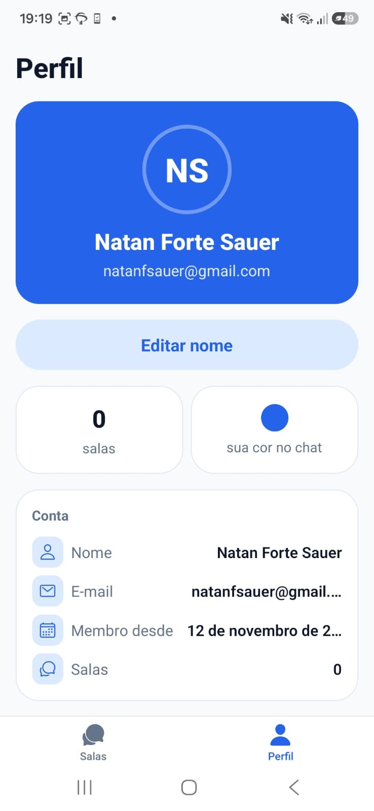
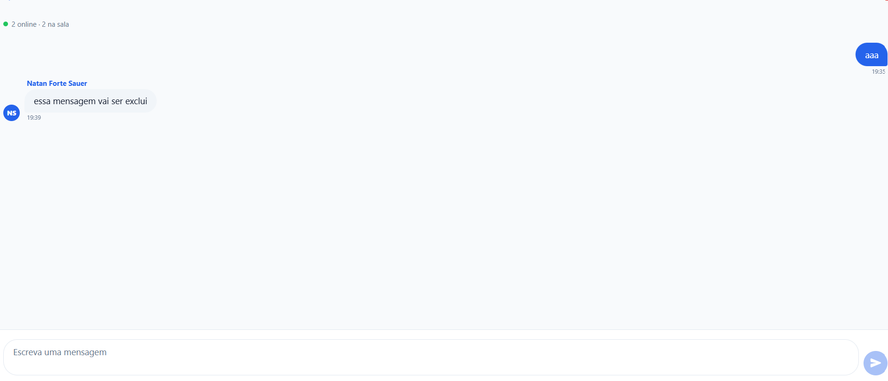
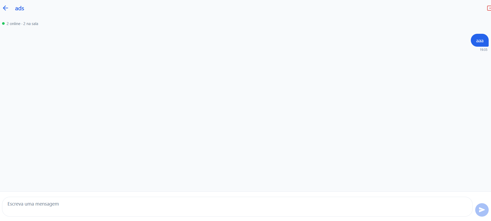

# ChatRoom

App de mensagens em tempo real: entre em salas públicas, converse e veja quem
está online e quem está digitando — tudo atualizando sozinho, sem precisar
puxar a tela para atualizar.

Projeto 4 de 5 da disciplina Programação para Dispositivos Móveis (IESB),
construído a partir do guia do Prof. Me. Bruno Assunção Dias, com as correções
descritas no [relatório](docs/RELATORIO-CORRECOES.md) (procure `CORREÇÃO` no código:
`grep -rn "CORREÇÃO" app src supabase`).

## Funcionalidades

- Cadastro e login (e-mail e senha)
- **Perfil automático**: nome e cor do avatar são criados sozinhos no cadastro
- Lista de salas públicas, com contagem de participantes
- Criar uma sala (com emoji e descrição) e entrar/sair de salas
- **Mensagens em tempo real** (Supabase Realtime): aparecem em todos os
  aparelhos abertos na mesma sala, sem precisar atualizar
- Envio **otimista**: a mensagem aparece na hora, e é confirmada depois
- **Presença**: contador de quem está online na sala agora
- **"Fulano está digitando..."**: aviso efêmero, que não grava nada no banco
- Apagar a própria mensagem; editar o nome exibido no Perfil

## Capturas de tela

| Salas | Criar sala | Conversa | Perfil |
| --- | --- | --- | --- |
|  |  |  |  |

| Nenhuma sala ainda | Apagar mensagem | Sair da sala |
| --- | --- | --- |
|  |  |  |

**Tempo real entre dois aparelhos** (celular + navegador, contas diferentes):

| 2 online | "Digitando..." | Mensagem chegando |
| --- | --- | --- |
|  |  |  |

Do outro lado (navegador, conta teste123): mensagem apagada no celular some sozinha.

| Antes de apagar | Depois de apagar no celular |
| --- | --- |
|  |  |

## Relatório de correções

O relatório com todos os problemas encontrados (C01 a C29), os prompts usados, as
respostas da IA e as soluções está em
[`docs/RELATORIO-CORRECOES.md`](docs/RELATORIO-CORRECOES.md).

## Tecnologias

React Native · Expo SDK 54 · Expo Router · TypeScript · Supabase (Auth,
Postgres, RLS, **Realtime**: `postgres_changes`, Presence e Broadcast) ·
TanStack Query · React Hook Form · Zod · Jest · PGlite (testes do banco)

## Como executar (Windows)

1. Rode **`1-instalar.bat`** (instala as dependências e cria o `.env`).
2. Crie um projeto no [Supabase](https://supabase.com) e execute
   `supabase/schema.sql` no **SQL Editor**.
3. Em **Database → Publications** (ou **Replication**), confirme que a tabela
   `messages` está marcada para o Realtime (o `schema.sql` já faz isso).
4. Em **Project Settings → API**, copie a URL e a chave `anon`/`publishable`
   para o `.env`.
5. Para testar sem confirmar e-mail: **Authentication → Sign In / Providers →
   Email → desligar "Confirm email"** (opcional).
6. Rode **`2-iniciar.bat`** e leia o QR Code com o **Expo Go do SDK 54**.
   Se o celular não conectar, use **`3-iniciar-tunel.bat`**.

Em outro sistema: `npm install`, `npx expo install --fix`, copiar
`.env.example` para `.env` e `npx expo start -c`.

> O projeto está fixado no **Expo SDK 54**. Se o Expo Go da loja for de
> outro SDK, instale o Expo Go do SDK 54 pelo site expo.dev/go (Android).

### Testar o tempo real

Abra a mesma sala em dois aparelhos com contas diferentes (ou o celular e o
navegador com `npx expo start --web`). Mensagens, contador de online,
"digitando..." e mensagens apagadas devem aparecer no outro lado sozinhos.

## Testes

| Comando            | O que testa                                                        |
| ------------------ | ------------------------------------------------------------------ |
| `npm test`         | Tudo: app (Jest) e banco (PGlite)                                  |
| `npm run test:app` | 31 testes: agrupamento e envio otimista, avatar, digitação, erros  |
| `npm run test:db`  | 14 testes: RLS, gatilho de perfil, participação e privilégios anon |

O teste do banco usa o PGlite (Postgres real dentro do Node), com o mesmo
`schema.sql` do Supabase e os privilégios padrão do Supabase reproduzidos —
sem Docker.

## Arquitetura

```
app/         rotas (Expo Router)
src/
  components/ interface: balão de mensagem, avatar, cartão de sala...
  context/    sessão do usuário
  hooks/      salas, mensagens (com Realtime), presença, digitação
  services/   acesso ao Supabase
  utils/      agrupamento de mensagens, avatar, indicador, erros, confirmação
supabase/
  schema.sql  banco, RLS, o gatilho de perfil e a função is_room_member
  tests/      testes do banco
docs/         relatório de correções e capturas de tela
```

## Autor

**Natan Sauer** — [github.com/natansauer](https://github.com/natansauer)
